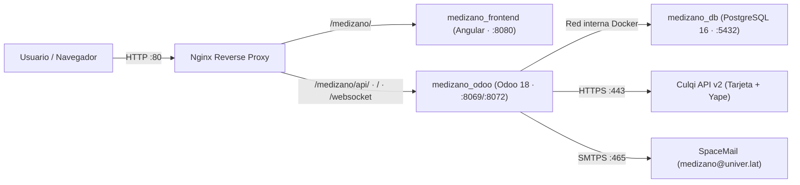

# Auditoría Integral — MediZano Botica

**Servidor:** `ec2-34-207-242-153.compute-1.amazonaws.com` (`ip-172-31-25-47`, Ubuntu Linux `7.0.0-1017-aws`)  
**Base de datos:** `medizano_test` (PostgreSQL 16 Alpine)  
**Fecha de auditoría:** 24 de noviembre de 2026  

> [!TIP]
> **Resultado global: OPERATIVO (Apto para pruebas / demo completa).** Todos los servicios principales, integridad contable-financiera, stock, pagos con **Efectivo / Culqi (Tarjeta) / Yape**, generación de boletas y envío de correos funcionan con **0 errores** en logs. Antes de salir a producción real solo faltan controles de infraestructura (HTTPS, claves `live` y backups automáticos).

---

## 1. Arquitectura e Infraestructura

| Componente | Imagen / Servicio | Estado | Política de reinicio | Exposición de red |
| :--- | :--- | :--- | :--- | :--- |
| **Reverse Proxy** | `nginx` (sistema) | Activo (`active`) | `systemd` | Público `:80` |
| **Frontend POS** | `medizano-frontend:sso-bidirectional` | Activo (`healthy`) | `unless-stopped` | Solo `127.0.0.1:8080` |
| **Backend ERP/API** | `odoo:18.0` (`workers=2`, `proxy_mode=True`) | Activo (`HTTP 200`) | `unless-stopped` | Solo `127.0.0.1:8069 / 8072` |
| **Base de Datos** | `postgres:16-alpine` | Activo | `unless-stopped` | Solo red interna Docker `:5432` |

### Recursos del servidor
- **CPU / Carga:** `load average: 0.00, 0.02, 0.09` (holgado).
- **Memoria RAM:** `1.2 GiB` usados de `3.7 GiB` (`2.5 GiB` disponibles; Swap `0 B` de `4.0 GiB`).
- **Disco (`/`):** `13 GB` usados de `28 GB` (**46%**, `16 GB` libres).
- **Puertos públicos escuchando:** únicamente `:22` (SSH) y `:80` (HTTP). Ningún puerto interno (PostgreSQL, Odoo, frontend) está expuesto a Internet.

---

## 2. Auditoría Funcional por Módulo

| Módulo | Estado | Verificación realizada |
| :--- | :--- | :--- |
| **Autenticación y SSO** | ✅ Operativo | SSO bidireccional `/sso/frontend` y `/sso/odoo` activo; 7 usuarios activos (`admin`, `cajero`, `inventario`, `almacen`, `soporte`, `analista`, `gerente`). |
| **Ventas / POS (Efectivo)** | ✅ Operativo | Sesión `MediZano POS - Sede Principal` abierta; cálculo exacto de vuelto, boleta `B001-...` y descuento de stock FEFO. |
| **Culqi Checkout v4 (Tarjeta)** | ✅ Operativo | Integrado en `/api/v1/pagos/culqi/charge` con `pk_test_BlqRZA1tNjak6hyn` / `sk_test_****************`. Confirmación inmediata, registro bajo `Tarjeta (Débito / Crédito)`. |
| **Yape vía Culqi** | ✅ Operativo | Pestaña dedicada **YAPE** en el POS; modal directo de Yape (celular + código 6 dígitos), registro bajo método POS `Yape` y boleta `YAPE (CULQI)`. Verificado con cargos reales en sandbox (`chr_test_nduV248IcwSmFte9`, `chr_test_9qVpTSveFmktkqMV`). |
| **Mercado Pago** | ⚠️ Sandbox | Credenciales de cuenta `TESTUSER2814251767996719062` válidas y corregido el bug de `payer.email` en sandbox. *(Opcional: ocultar pestaña si solo usarán Culqi/Yape).* |
| **Facturación e Historial** | ✅ Operativo | 97 comprobantes correlativos (`B001-00000001` → `B001-00000097`), 0 duplicados, cajeros reales (0 `OdooBot`), totales sincronizados con líneas y pagos. |
| **Comprobante por Correo (SMTP)** | ✅ Operativo | `SpaceMail MediZano` (`mail.spacemail.com:465`, `medizano@univer.lat`, `from_filter=univer.lat`). Corregido el bug de búsqueda de orden por `seriesNumber` y renovado el diseño HTML en español con QR de verificación. |
| **Reportes (Ventas, Caja, BSC)** | ✅ Operativo | Fechas corregidas a formato peruano `dd/MM/yyyy` (día/mes/año). 19 indicadores BSC activos, reportes de caja y ventas consistentes con POS. |
| **Inventario, Lotes y Kardex** | ✅ Operativo | 212 productos activos (0 con precio `0`), 12,475 unidades totales, **0 quants con stock negativo**. Control de lotes FEFO y vencimientos activos. |
| **Compras, Proveedores y Devoluciones** | ✅ Operativo | 10 proveedores, 5 órdenes de compra, 1 devolución registrada, 170 registros de dispensación y 106 eventos en `pharmacy_audit_log`. |

---

## 3. Integridad Financiera y de Datos (`medizano_test`)

| Control de integridad | Resultado | Esperado | Estado |
| :--- | :---: | :---: | :---: |
| Comprobantes emitidos (`paid`/`done`/`invoiced`) | **97** (`B001-00000001`..`0097`) | Correlativos | ✅ |
| Total acumulado de ventas emitidas | **S/ 14,322.50** | Exacto | ✅ |
| Órdenes con descuadre entre total y suma de líneas | **0** | `0` | ✅ |
| Órdenes con descuadre entre total y suma de pagos | **0** | `0` | ✅ |
| Boletas duplicadas o sin serie `B001-...` | **0** | `0` | ✅ |
| Ventas atribuidas a `OdooBot` | **0** | `0` | ✅ |
| Productos activos con precio `<= 0` | **0** (de 212 activos) | `0` | ✅ |
| Ubicaciones internas con stock negativo | **0** | `0` | ✅ |
| Lotes vencidos / por vencer (30 d / 90 d) | **1** vencido · **23** (≤30 d) · **32** (31–90 d) | Monitoreado | ⚠️ Revisar lote vencido |

### Distribución de pagos y cajeros
- **Métodos de pago:** Efectivo (`39`), Tarjeta/Culqi (`29`), Yape/Culqi (`29`).
- **Cajeros:** `Cajero`, `Administrador Maestro` y `Gerente` (sin registros de `OdooBot`).
- **Correos de clientes:** todos normalizados al dominio `@univer.lat`.

---

## 4. Auditoría de Seguridad

### Controles verificados correctamente
- **Protección de APIs:** los endpoints probados sin sesión (`/api/cashier/bills`, `/api/admin/users`, `/api/v1/pagos/config`, `/api/admin/reports/bsc`, `/api/v1/facturacion/enviar-correo`) responden **`401 Unauthorized`**.
- **Gestor de bases de datos Odoo deshabilitado:** `list_db = False` en `/opt/medizano/config/odoo.conf`.
- **Aislamiento de servicios:** PostgreSQL, Odoo y el frontend solo escuchan en `localhost`/red Docker.
- **Trazabilidad:** `pharmacy_audit_log` activo (106 registros) y `pharmacy_login_challenge` / `pharmacy_login_security` operativos.

### Brechas y plan de acción recomendado

> [!CAUTION]
> **Prioridad P0 (Obligatorio antes de producción real)**
> 1. **Habilitar HTTPS (TLS/SSL) con dominio propio:** actualmente `nginx` sirve únicamente por HTTP `:80` (`http://34.207.242.153`). Sin HTTPS, las credenciales viajan sin cifrar, el escáner con cámara falla en navegadores modernos y Culqi en modo producción exige HTTPS.
> 2. **Cambiar claves de Culqi a producción (`pk_live_...` / `sk_live_...`):** actualmente están activas las llaves de sandbox (`pk_test_...` / `sk_test_...`).

> [!WARNING]
> **Prioridad P1 (Recomendado a corto plazo)**
> 3. **Automatizar respaldos diarios de PostgreSQL:** el último backup en `/opt/medizano/backups` es del `2026-11-06` y no existe ningún `cron` configurado. Se recomienda `pg_dump` diario a las 03:00 con retención de 14 días (y copia externa a S3).
> 4. **Activar Firewall UFW + cabeceras de seguridad en Nginx:** `ufw` está `inactive` en el host; habilitar `22/tcp`, `80/tcp`, `443/tcp` y agregar `X-Frame-Options`, `X-Content-Type-Options`, `Referrer-Policy` y `Strict-Transport-Security` (al activar HTTPS).

> [!NOTE]
> **Prioridad P2 (Mejoras de higiene y mantenimiento)**
> 5. **Forzar MFA para administradores (`pharmacy.enforce_mfa = True`)** al pasar a producción.
> 6. **Definir límites de memoria en Docker** (`mem_limit`) para evitar que un pico de Odoo o Postgres afecte al host.
> 7. **Limpieza menor:** retirar el único lote vencido del inventario disponible, depurar los 39 correos históricos fallidos en `mail_mail` (`state = 'exception'`) y ocultar la pestaña de Mercado Pago si solo operarán con Efectivo, Culqi y Yape.
