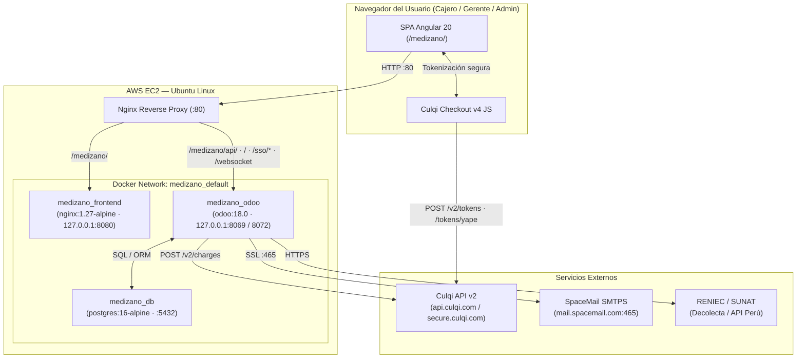
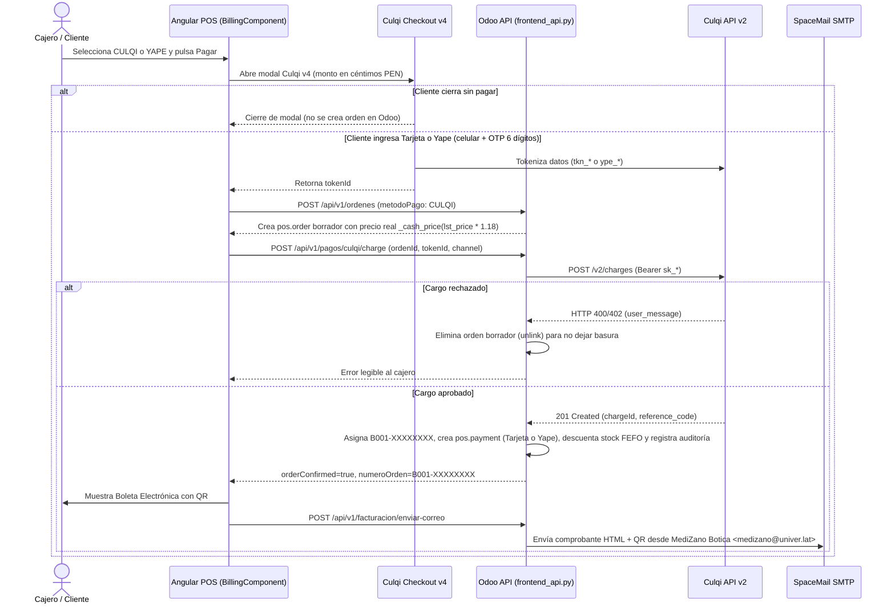
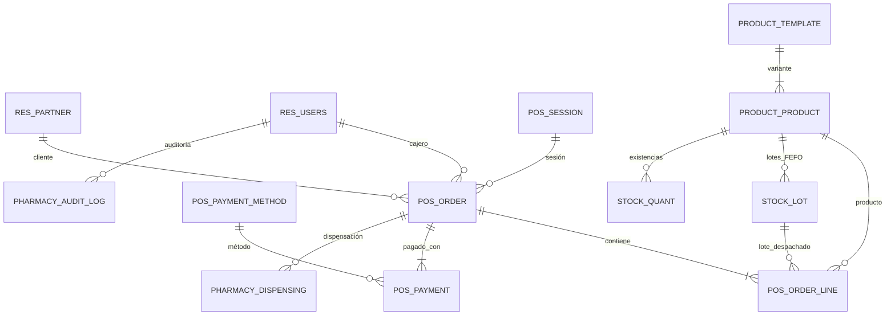

# Documentación Completa del Proyecto — MediZano Botica

**Nombre del sistema:** MediZano — Sistema ERP & POS de Farmacia y Botica (Perú)  
**Versión:** `18.0.1.0.0` (Backend Odoo) · `1.0.0` (Frontend Angular 20)  
**Entorno productivo/pruebas AWS:** `ec2-54-172-235-163.compute-1.amazonaws.com` (`54.172.235.163`)  
**Fecha de elaboración:** 24 de noviembre de 2026  

---

## 1. Visión General y Alcance

**MediZano Botica** es una plataforma integral de gestión farmacéutica y punto de venta (POS) adaptada a la normativa peruana (IGV 18%, medicamentos exonerados Ley 29459, control obligatorio de lotes **FEFO** — *First Expired, First Out*, comprobantes electrónicos serie `B001-...` con código QR, y medios de pago locales).

### 1.1 Objetivos del sistema
- Centralizar ventas presenciales/electrónicas, inventario por lotes, compras, proveedores, clientes, devoluciones y contabilidad en una única base de datos auditable.
- Garantizar trazabilidad farmacéutica (lotes, fechas de vencimiento, kardex, recetas y registro de sustancias controladas).
- Agilizar el cobro en caja con **Efectivo**, **Culqi (Tarjetas Visa, Mastercard, Amex, Diners)** y **Yape vía Culqi**, emitiendo boleta electrónica y enviándola automáticamente por correo.
- Proveer indicadores gerenciales en tiempo real: reporte diario de ventas, caja diaria y **Balanced Scorecard (BSC)**.

### 1.2 Stack tecnológico

| Capa | Tecnología | Versión / Detalle |
| :--- | :--- | :--- |
| **Frontend POS Web** | Angular + TypeScript + Bootstrap + RxJS | Angular `20.3`, TS `5.9`, Bootstrap `5.3`, `@zxing/library 0.21.3` (lector de barras y QR) |
| **Backend ERP & API** | Odoo Community + Módulo `Pharmacy` | Odoo `18.0`, Python 3, `l10n_pe`, `l10n_pe_pos`, `wkhtmltopdf 0.12.6.1`, `qrcode` |
| **Base de Datos** | PostgreSQL | `postgres:16-alpine` (BD activa: `medizano_test`) |
| **Reverse Proxy** | Nginx | Proxy inverso del host (`/medizano/`, `/medizano/api/`, `/`, `/websocket`) + Nginx interno del contenedor frontend |
| **Contenedores / Cloud** | Docker en AWS EC2 | Ubuntu Linux `7.0.0-1017-aws`, red Docker `medizano_default` |
| **Pasarela de Pagos** | Culqi Checkout v4 & API v2 | `https://checkout.culqi.com/js/v4`, `https://api.culqi.com/v2/charges` (Tarjeta + Yape) |
| **Correo Transaccional** | SpaceMail (SMTPS) | `mail.spacemail.com:465` (SSL), cuenta principal `medizano@univer.lat` (`from_filter=univer.lat`) |
| **Consulta DNI / RUC** | API Perú / Decolecta | Autocompletado de clientes y proveedores en facturación y compras |

---

## 2. Arquitectura del Sistema

### 2.1 Arquitectura de Despliegue (AWS EC2)



### 2.2 Flujo de Cobro Electrónico (Culqi Tarjeta / Yape) + Boleta + Correo



---

## 3. Arquitectura del Backend — Odoo 18 (`Pharmacy`)

Ubicación en el servidor: `/opt/medizano/addons/Pharmacy/`  
Dependencias declaradas en `__manifest__.py`: `base`, `mail`, `contacts`, `product`, `stock`, `purchase`, `point_of_sale`, `account`, `web`, `l10n_pe`, `l10n_pe_pos`.

### 3.1 Módulos y Modelos Python (`models/`)

| Dominio | Modelos principales | Responsabilidad |
| :--- | :--- | :--- |
| **Sucursales y POS** | `pharmacy_branch.py`, `pos_config.py`, `pos_session.py`, `pos_order.py` | Gestión multisucursal, apertura/cierre de sesiones POS, órdenes de venta con campos `medizano_payment_method` (`CASH`, `CULQI`, `PAYPAL`, `MERCADO_PAGO`), `medizano_provider_order_id`, `medizano_provider_payment_id`, `medizano_customer_email`. |
| **Inventario y Lotes FEFO** | `product_template.py`, `stock_location.py`, `stock_lot.py`, `stock_picking.py`, `stock_picking_variance.py`, `pharmacy_dosage_form.py` | Catálogo de medicamentos (principio activo, concentración, forma farmacéutica, receta), lotes con vencimiento obligatorio, selección FEFO, control de mermas y discrepancias en recepción. |
| **Compras y Proveedores** | `purchase_order.py`, `purchase_order_provider.py`, `res_partner.py` | Órdenes de compra, catálogo por proveedor, recepción con registro de lotes y portal de proveedores. |
| **Clínica y Farmacia** | `pharmacy_patient.py`, `pharmacy_prescription.py`, `pharmacy_dispensing.py`, `pharmacy_controlled_substance_register.py` | Pacientes, prescripciones médicas, historial de dispensación y libro de sustancias controladas. |
| **Seguros y Precios** | `pharmacy_insurer.py`, `pharmacy_patient_insurance.py`, `pharmacy_coverage_rule.py`, `pharmacy_claim.py`, `pharmacy_pricing.py`, `pharmacy_discount_rule.py` | Aseguradoras, planes, copagos, reclamos, listas de precios y reglas de descuento. |
| **Contabilidad, Reportes y BSC** | `pharmacy_accounting.py`, `pharmacy_reports.py`, `pharmacy_bsc.py`, `pharmacy_dashboard.py` | Reportes financieros, ventas diarias, caja diaria, tablero de control y Balanced Scorecard (19 indicadores KPI). |
| **Seguridad y Auditoría** | `pharmacy_audit_log.py`, `pharmacy_login_security.py`, `res_users.py`, `res_config_settings.py` | Registro inmutable de eventos (`pharmacy_audit_log`), bloqueo ante fuerza bruta, desafíos MFA de 6 dígitos (`pharmacy_login_challenge`) y mapeo de roles. |
| **Integraciones Perú** | `decolecta_service.py`, `pharmacy_sunat_integration.py` | Consulta DNI/RUC (RENIEC/SUNAT) y estructura preparada para facturación electrónica SUNAT. |

### 3.2 Reglas de Negocio Críticas
1. **Cálculo de Precio Público e IGV 18%:**
   - En Odoo, `product.lst_price` almacena el precio base **sin IGV**.
   - El precio de venta al público se calcula con redondeo comercial peruano a múltiplos de `S/ 0.10`:
     $$\text{precio\_público} = \frac{\lceil (\text{lst\_price} \times 1.18 - 10^{-9}) \times 10 \rceil}{10}$$
   - El desglose tributario en boleta y contabilidad calcula $\text{Subtotal} = \text{round}(\text{Total} / 1.18, 2)$ y $\text{IGV} = \text{round}(\text{Total} - \text{Subtotal}, 2)$.
2. **Despacho FEFO Obligatorio:** al vender un medicamento con trazabilidad por lote, el sistema selecciona automáticamente el lote vigente (`expiry_date > hoy`) más próximo a vencer con stock suficiente en la ubicación del POS.
3. **Correlativo de Boletas (`B001-XXXXXXXX`):** administrado mediante la secuencia `ir.sequence` (`code = medizano.pos.receipt`), sincronizada en `B001-00000001`..`B001-00000097` sin duplicados ni saltos.
4. **Cero órdenes borrador huérfanas:** en cobros con Culqi/Yape, la orden solo se crea tras recibir el token del cliente y se elimina automáticamente (`unlink`) si Culqi rechaza el cargo.

### 3.3 Controladores HTTP (`controllers/`)
- `frontend_api.py`: punto único `/api/<resource>` + `/sso/frontend` y `/sso/odoo` (SSO bidireccional por cookie HttpOnly de sesión Odoo).
- `pharmacy_dashboard.py`: endpoints de métricas ejecutivas para el dashboard de Odoo.
- `provider_portal.py`: portal de interacción con proveedores.
- `supplier_lookup.py`: consulta de RUC/DNI de proveedores y clientes.

---

## 4. Arquitectura del Frontend — Angular 20 (`medizano-frontend`)

Ubicación en el servidor: `/opt/medizano/clients/medizano-frontend/`  
Compilación: `ng build` (multi-stage Dockerfile: `node:20-alpine` → `nginx:1.27-alpine`) con `useHash: true` y `<base href="/medizano/">`.

### 4.1 Módulos, Rutas y Matriz de Acceso por Rol (RBAC)

Roles definidos en `UserRole`: `ADMIN`, `MANAGER`, `CASHIER`, `STOCK_MONITOR`, `STOCK_KEEPER`, `WAREHOUSE`, `CUSTOMER_SUPPORT`, `ANALYST`.

| Ruta (`#/`) | Módulo Angular | Roles autorizados | Funcionalidad principal |
| :--- | :--- | :--- | :--- |
| `/auth/login` | `LoginModule` | Público | Acceso con usuario/contraseña (soporte directo y MFA de 6 dígitos) con diseño esmeralda MediZano. |
| `/dashboard` | `DashboardModule` | Autenticados | Panel principal de resumen operativo. |
| `/billing` | `BillingModule` | `CASHIER`, `ADMIN` | POS en 3 pasos (Canasta + escáner → Cliente RENIEC/SUNAT → Pago: **EFECTIVO**, **CULQI**, **YAPE**), boleta modal con QR y envío de correo. |
| `/purchase-history` | `PurchaseHistoryModule` | `MANAGER`, `ADMIN` | Historial de facturación, búsqueda en vivo, totales, badges por método de pago (`Efectivo`, `Yape`, `Tarjeta`) y reimpresión/reenvío. |
| `/inventory` | `InventoryModule` | `STOCK_MONITOR`, `STOCK_KEEPER`, `MANAGER`, `ADMIN` | Gestión de medicamentos, lotes FEFO, alertas de stock mínimo y vencimientos. |
| `/purchases` | `PurchasesModule` | `MANAGER`, `STOCK_MONITOR`, `STOCK_KEEPER`, `ADMIN` | Órdenes de compra, estado de pedidos, recepciones y escaneo de productos. |
| `/suppliers` | `SuppliersModule` | `MANAGER`, `STOCK_MONITOR`, `STOCK_KEEPER`, `ADMIN` | Directorio y catálogo de proveedores. |
| `/returns` | `ReturnsModule` | `CUSTOMER_SUPPORT`, `MANAGER`, `ADMIN` | Devoluciones de ventas, notas de crédito y reingreso de stock. |
| `/reports` | `ReportsModule` | `ANALYST`, `MANAGER`, `ADMIN` | Reporte diario de ventas (fechas `dd/MM/yyyy`), caja diaria y alertas de vencimiento. |
| `/bsc` | `BscModule` | `ANALYST`, `MANAGER`, `ADMIN` | Balanced Scorecard con 4 perspectivas e indicadores KPI configurables. |
| `/user-management` | `UserManagementModule` | `ADMIN` | Alta, edición, activación y asignación de roles de usuarios. |
| `/user-activity` | `UserActivityModule` | `ADMIN` | Auditoría detallada de acciones de usuarios. |
| `/login-history` | `LoginHistoryModule` | `ADMIN` | Historial de inicios/cierres de sesión e intentos fallidos. |

### 4.2 Servicios Core (`src/app/core/services/`)
- **Autenticación y API:** `auth.service.ts`, `api.service.ts`, `auth.guard.ts`, `role.guard.ts`, `token.interceptor.ts`.
- **Ventas y Pagos:** `billing.service.ts`, `orden.service.ts`, `culqi.service.ts` (carga dinámica de Culqi Checkout v4 en modo Tarjeta+Yape o Yape directo), `return.service.ts`.
- **Operaciones:** `inventory.service.ts`, `compra.service.ts`, `proveedor.service.ts`, `cliente.service.ts`, `api-peru.service.ts`.
- **Analítica y UX:** `report.service.ts`, `audit-log.service.ts`, `user.service.ts`, `dialog.service.ts`, `theme.service.ts`.

---

## 5. Catálogo de la API REST (`/api/...`)

Todas las rutas protegidas validan la sesión activa de Odoo (`401 Unauthorized` sin sesión) y el rol del usuario (`403 Forbidden` si no tiene permiso).

| Grupo | Endpoint | Métodos | Roles permitidos | Descripción |
| :--- | :--- | :--- | :--- | :--- |
| **Autenticación y SSO** | `/api/auth/login` | `POST` | Público | Valida credenciales, controla bloqueo por fuerza bruta y dispara MFA si `pharmacy.enforce_mfa=True`. |
| | `/api/auth/verify-code` · `/resend-code` | `POST` | Público | Verifica o reenvía el código OTP de 6 dígitos. |
| | `/api/auth/sso-status` · `/logout` | `GET` / `POST` | Sesión | Consulta estado de sesión SSO o cierra sesión registrando auditoría. |
| | `/sso/frontend` · `/sso/odoo` | `GET` | Sesión | Redirección bidireccional entre el frontend Angular y el backend Odoo. |
| **POS y Facturación** | `/api/cashier/bills` · `/cashier/bills/<id>` | `GET`, `POST` | `ADMIN`, `MANAGER`, `SUPPORT`, `CASHIER`, `ANALYST` | Emite ventas en efectivo y consulta historial de comprobantes. |
| | `/api/cashier/returns` | `GET`, `POST` | `ADMIN`, `MANAGER`, `SUPPORT`, `CASHIER` | Registra y consulta devoluciones de boletas. |
| | `/api/cashier/session` | `GET`, `POST` | `ADMIN`, `MANAGER`, `SUPPORT`, `CASHIER`, `ANALYST` | Estado y resumen de caja de la sesión POS activa. |
| | `/api/v1/ordenes` | `GET`, `POST` | `ADMIN`, `MANAGER`, `SUPPORT`, `CASHIER` | Crea órdenes electrónicas con precio real `_cash_price(lst_price * 1.18)`. |
| | `/api/v1/facturacion/orden/<id>/pdf` | `GET` | `ADMIN`, `MANAGER`, `SUPPORT`, `CASHIER`, `ANALYST` | Genera el comprobante en PDF vía `wkhtmltopdf`. |
| | `/api/v1/facturacion/enviar-correo` | `POST` | `ADMIN`, `MANAGER`, `SUPPORT`, `CASHIER` | Envía boleta electrónica HTML + QR por SMTP (búsqueda exacta por `billId`/`pos_reference`). |
| **Pasarela de Pagos** | `/api/v1/pagos/config` | `GET` | `ADMIN`, `MANAGER`, `SUPPORT`, `CASHIER` | Devuelve llave pública de Culqi (`culqiPublicKey`) y moneda `PEN`. |
| | `/api/v1/pagos/culqi/charge` | `POST` | `ADMIN`, `MANAGER`, `SUPPORT`, `CASHIER` | Ejecuta cargo en `api.culqi.com/v2/charges`, detecta canal `CARD`/`YAPE`, confirma orden y asigna `B001-...`. |
| **Inventario y Compras** | `/api/pharmacist/medicines` · `/batches` | `GET`, `POST`, `PUT` | `ADMIN`, `MANAGER`, `WAREHOUSE`, `STOCK_KEEPER`, `SUPPORT`, `CASHIER` | CRUD de medicamentos y lotes FEFO. |
| | `/api/v1/inventario/kardex` · `/movimientos` | `GET` | `ADMIN`, `MANAGER`, `WAREHOUSE`, `STOCK_KEEPER`, `ANALYST` | Kardex valorizado y movimientos de almacén. |
| | `/api/v1/proveedores` · `/catalogo-proveedores` · `/compras` | `GET`, `POST`, `PUT` | `ADMIN`, `MANAGER`, `WAREHOUSE`, `STOCK_KEEPER` | Gestión de proveedores, catálogos y órdenes de compra. |
| | `/api/v1/clientes` | `GET`, `POST`, `PUT` | `ADMIN`, `MANAGER`, `SUPPORT`, `CASHIER` | Gestión y búsqueda de clientes. |
| **Reportes y Admin** | `/api/admin/reports/*` · `/admin/bsc/targets` | `GET`, `POST` | `ADMIN`, `MANAGER`, `ANALYST` | Ventas diarias, caja, vencimientos y metas BSC. |
| | `/api/admin/users` · `/admin/users/<id>` | `GET`, `POST`, `PUT` | `ADMIN` | Administración de usuarios y roles. |
| | `/api/admin/audit/*` | `GET` | `ADMIN` | Consulta de logs de auditoría y accesos. |

---

## 6. Modelo de Datos (PostgreSQL `medizano_test`)



### Diccionario de tablas principales
- `pos_order`: cabecera de ventas (`pos_reference` serie `B001-...`, `amount_total`, `amount_tax`, `amount_paid`, `medizano_payment_method`, `medizano_provider_payment_id`, `medizano_customer_email`, `branch_id`).
- `pos_order_line`: detalle por producto (`product_id`, `qty`, `price_unit`, `price_subtotal`, `price_subtotal_incl`, `lot_id`).
- `pos_payment` y `pos_payment_method`: medios de pago registrados (`Efectivo`, `Tarjeta (Débito / Crédito)`, `Yape`, `Plin`, `Seguro / Convenio`).
- `product_template` / `product_product`: catálogo de medicamentos (`list_price` sin IGV, `standard_price`, `barcode`, `generic_name`, `strength`, `is_prescription_required`).
- `stock_lot` y `stock_quant`: control de lotes, fechas de vencimiento (`expiry_date`) y stock por ubicación.
- `pharmacy_audit_log`, `pharmacy_login_security`, `pharmacy_login_challenge`: trazabilidad de seguridad y accesos.
- `pharmacy_bsc_indicator`, `pharmacy_dispensing`, `pharmacy_branch`, `pharmacy_patient`, `pharmacy_prescription`, `pharmacy_controlled_substance_register`: tablas propias del dominio farmacéutico.
- `ir_config_parameter` e `ir_mail_server`: configuración de claves Culqi (`medizano.culqi.*`), dominio de correo (`mail.default.from`, `mail.force.smtp.from`, `mail.catchall.domain`), `web.base.url` y servidor SMTP SpaceMail.

---

## 7. Infraestructura, Despliegue y Operación

### 7.1 Contenedores y Rutas en el Servidor
- **Directorio raíz del proyecto:** `/opt/medizano/`
  - `docker-compose.yml`: orquesta `medizano_db` (`postgres:16-alpine`) y `medizano_odoo` (`odoo:18.0`).
  - `config/odoo.conf`: `list_db = False`, `proxy_mode = True`, `workers = 2`, `db_name = medizano_test`.
  - `addons/Pharmacy/`: código fuente del módulo ERP Odoo.
  - `clients/medizano-frontend/`: código fuente Angular 20 + `Dockerfile` + `nginx.conf` (con `Cache-Control: no-store, no-cache` en `index.html`).
  - `backups/`: respaldos `.dump` de PostgreSQL.
- **Nginx del host:** `/etc/nginx/sites-enabled/medizano` (enruta `/medizano/` al contenedor `:8080`, `/medizano/api/` y `/` a Odoo `:8069`, y `/websocket` a `:8072`).

### 7.2 Comandos Operativos Clave
- **Ver estado de servicios:**
  ```bash
  docker ps && systemctl status nginx --no-pager
  ```
- **Reiniciar backend Odoo tras cambios en `Pharmacy`:**
  ```bash
  python3 -m py_compile /opt/medizano/addons/Pharmacy/controllers/frontend_api.py && docker restart medizano_odoo
  ```
- **Recompilar y redesplegar frontend Angular:**
  ```bash
  cd /opt/medizano/clients/medizano-frontend && \
  docker build -t medizano-frontend:sso-bidirectional . && \
  docker stop medizano_frontend && docker rm medizano_frontend && \
  docker run -d --name medizano_frontend --network medizano_default --restart unless-stopped -p 127.0.0.1:8080:80 medizano-frontend:sso-bidirectional
  ```
- **Respaldo manual de PostgreSQL:**
  ```bash
  docker exec medizano_db pg_dump -U odoo -Fc medizano_test > /opt/medizano/backups/medizano_$(date +%F_%H%M).dump
  ```

### 7.3 Checklist de Paso a Producción
1. **Dominio + HTTPS (Let's Encrypt / Certbot):** configurar dominio (ej. `medizano.univer.lat`), habilitar puerto `443` con SSL y actualizar `web.base.url` a `https://...`.
2. **Llaves Culqi Producción:** actualizar `medizano.culqi.public_key` (`pk_live_...`) y `medizano.culqi.secret_key` (`sk_live_...`) en `ir_config_parameter`.
3. **Respaldos automáticos:** programar cron diario de `pg_dump` con retención de 14 días.
4. **Firewall UFW + MFA:** activar UFW (`22`, `80`, `443`) y opcionalmente activar `pharmacy.enforce_mfa = True` para cuentas administrativas.

---

## 8. Manual Rápido de Usuario por Rol

| Rol | Flujo diario principal |
| :--- | :--- |
| **Cajero (`CASHIER`)** | 1. Ingresar a **Ventas / POS** (`/billing`).<br>2. Escanear o buscar medicamentos y ajustar cantidades.<br>3. En **Cliente**, buscar por DNI/RUC o ingresar correo (`@univer.lat` u otro) para envío automático.<br>4. En **Pago**, elegir **EFECTIVO** (con cálculo de vuelto), **CULQI** (tarjeta) o **YAPE** (celular + código de aprobación de 6 dígitos).<br>5. Imprimir/descargar ticket 80mm o reenviar boleta por correo. |
| **Inventario / Almacén (`STOCK_KEEPER` / `WAREHOUSE`)** | 1. Gestionar altas/precios en **Medicamentos e Inventario**.<br>2. Crear órdenes de compra en **Compras → Órdenes de Compra** y registrar recepciones ingresando lote y vencimiento.<br>3. Monitorear alertas de stock mínimo y lotes próximos a vencer (FEFO). |
| **Gerente / Analista (`MANAGER` / `ANALYST`)** | 1. Revisar comprobantes y pagos en **Facturación** (`/purchase-history`).<br>2. Consultar **Reportes → Ventas** y **Caja diaria** (fechas en `dd/MM/yyyy`).<br>3. Evaluar KPIs estratégicos en **BSC** (`/bsc`). |
| **Administrador (`ADMIN`)** | Acceso total a todos los módulos POS y ERP Odoo (`/odoo`), gestión de usuarios/roles (`/user-management`), auditoría de actividad (`/user-activity`) e historial de accesos (`/login-history`). |
